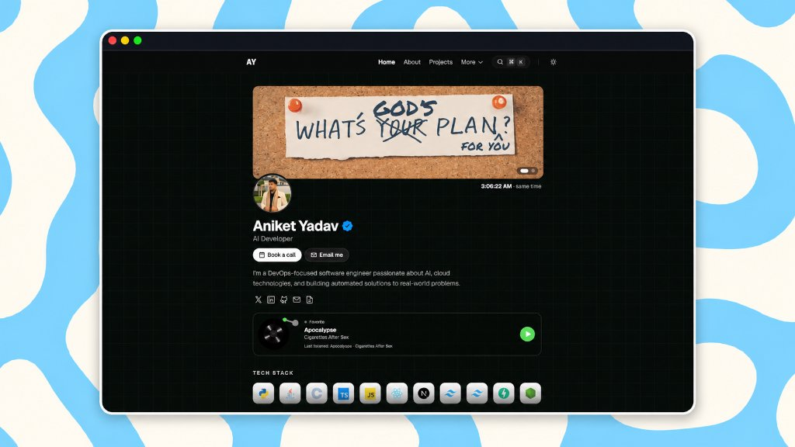

# Aniket Yadav — Portfolio

A personal developer portfolio showcasing my work, projects, technical skills, achievements, and journey in software engineering, AI development, cloud technologies, and DevOps.

**Live Website:** [aniketyadav.tech](https://aniketyadav.tech)  · **LinkedIn:** [aniketyadav9099](https://linkedin.com/in/aniketyadav9099/) · **Email:** aniketyadav0078@gmail.com

---

## Preview

<div align="center">
  
</div>

---

## Highlights

- **Home** — Hero slideshow with dual identity banners, verified badge, tech stack, experience, achievements, featured projects, GitHub contribution calendar, dynamic Gita wisdom, and visitor counter.
- **About** — Personal narrative, academic background at KSIT, and core approaches to software engineering.
- **Projects** — Interactive showcases with live demo and repository links for **ArcadeVerse**, **CodeBrain AI**, **QuizGenAI**, **Guardian AI**, and **Google Cloud Solutions**.
- **Experience** — Career timeline featuring roles at **Valency Energy** (AI/ML Intern) and **Allegion** (Incoming Graduate Engineer Trainee).
- **Achievements** — Hackathon runner-up honors at national-level **HIRE-4-THON 2026** with workstation and event photo gallery.
- **Resume** — In-browser interactive PDF viewer with text selection, clickable links, and direct download.
- **Books & Favourites** — Hand-curated reading lists and media recommendations.
- **Command Palette (`⌘K`)** — Global keyboard-driven search for instant navigation, theme switching, and quick links.
- **Theme Toggle** — Persistent dark mode by default with smooth light mode toggle.
- **Music Player** — Vinyl record widget with live spin animation and audio preview.
- **Cursor Pet (Pixel)** — Interactive companion following the cursor across desktop viewports.

---

## Tech Stack

| Layer | Tools |
|---|---|
| **Framework** | [Next.js 15](https://nextjs.org/) (App Router, Static Site Generation) |
| **Language** | [TypeScript](https://www.typescriptlang.org/) |
| **Styling** | [Tailwind CSS v4](https://tailwindcss.com/) |
| **UI Components** | [Radix UI](https://www.radix-ui.com/), [Motion](https://motion.dev/), [CMDK](https://cmdk.paco.me/) |
| **Icons** | [Phosphor Icons](https://phosphoricons.com/) & [Lucide](https://lucide.dev/) |
| **Content** | [MDX](https://mdxjs.com/) (`next-mdx-remote`, `gray-matter`) |
| **Analytics** | [Vercel Analytics](https://vercel.com/analytics) & [Speed Insights](https://vercel.com/docs/speed-insights) |
| **Deployment** | [Vercel](https://vercel.com/) |

---

## Getting Started

### Prerequisites

- **Node.js:** `v20.x` or later
- **npm:** `v10.x` or later

### Installation

```bash
# 1. Clone the repository
git clone https://github.com/AnniiGCP/Aniket-Portfolio.git

# 2. Navigate to the project directory
cd Aniket-Portfolio

# 3. Install dependencies
npm install

# 4. Start local development server
npm run dev
```

Open [http://localhost:3000](http://localhost:3000) in your browser.

### Available Scripts

| Command | Description |
|---|---|
| `npm run dev` | Starts the development server at `localhost:3000` |
| `npm run build` | Builds and statically pre-renders the site for production |
| `npm start` | Runs the compiled production build locally |
| `npm run lint` | Runs ESLint to check for code quality and errors |

---

## Project Structure

```
aniket-portfolio/
├── content/              # Long-form MDX case studies and blog articles
│   ├── blog/             # Optional blog articles
│   └── projects/         # Detailed project writeups
├── data/                 # Local data fallbacks (visitors.json)
├── public/               # Static assets
│   ├── assets/           # Profile portraits, project covers, and resume PDF
│   └── oneko/            # Sprite animations for the cursor pet
├── src/
│   ├── app/              # Next.js 15 App Router pages, layout, and API endpoints
│   ├── components/       # UI elements, liquid glass cards, and landing sections
│   ├── config/           # Site content and data configuration files
│   ├── data/             # Bhagavad Gita wisdom collection (201 teachings)
│   └── lib/              # Helper utilities, metadata builders, and GitHub API
├── .env.example          # Template for local environment variables
├── package.json          # Project dependencies and npm scripts
└── README.md             # Project documentation
```

---

## Customizing Content

Most portfolio content can be edited directly in `src/config/` without touching the UI components:

| File | What to Edit |
|---|---|
| `src/config/hero.ts` | Name, role, bio headline, avatar path, and social links |
| `src/config/projects.ts` | Project titles, descriptions, tech stacks, links, and cover images |
| `src/config/experience.ts` | Work history, roles, dates, locations, and bullet points |
| `src/config/achievements.ts` | Competitions, awards, dates, and gallery photos |
| `src/config/about.ts` | Personal story, education at KSIT, and engineering approach |
| `src/config/meta.ts` | Site title, SEO description, and canonical domain URL |

- **Adding a Project:** Add a new object to the `projects` array in `src/config/projects.ts`. Place its mockup screenshot inside `public/assets/projects/`. You can optionally add a matching `.mdx` writeup in `content/projects/<slug>.mdx`.
- **Updating Tech Stack:** Modify the technology pill lists in `src/config/hero.ts` or individual project items in `src/config/projects.ts`.
- **Publishing Blog Posts:** Create an MDX file in `content/blog/<slug>.mdx` with `title`, `date`, `description`, and `cover` in the frontmatter.

---

## Visitor Counter

The home page shows a live visitor count via `POST /api/visitors`.

| Environment | Storage |
|-------------|---------|
| **Local dev** | `data/visitors.json` (file on disk) |
| **Vercel / production** | [Upstash Redis](https://upstash.com/) (required) |

Vercel serverless functions have a **read-only filesystem** — writes to `data/visitors.json` are lost on every deploy, which is why the counter shows "Counting visitors..." forever in production.

### Set up Upstash (one-time, ~2 min)

1. Go to [console.upstash.com](https://console.upstash.com) and create a free Redis database
2. Copy **UPSTASH_REDIS_REST_URL** and **UPSTASH_REDIS_REST_TOKEN**
3. In Vercel → your project → **Settings → Environment Variables**, add both
4. Redeploy

Locally, copy `.env.example` to `.env.local` and fill in the same vars (optional — without them, the file store is used).

---

## Deploy

The easiest way to deploy this portfolio is with **Vercel**:

1. Push your repository to GitHub: `https://github.com/AnniiGCP/Aniket-Portfolio`.
2. Import the project into [Vercel](https://vercel.com/new).
3. Add the following **Environment Variables** in Vercel Project Settings:
   - `GITHUB_TOKEN`: Your GitHub Personal Access Token (for the live contribution calendar).
   - `NEXT_PUBLIC_SITE_URL`: `https://aniketyadav.tech`
4. Click **Deploy**. Vercel will run `npm run build` and launch the site on your domain with automatic SSL and global CDN distribution.

---

## License

This project is licensed under the [MIT License](LICENSE).

```
MIT License
Copyright (c) 2026 Aniket Yadav
```

---

<div align="center">
  <p>Built with late nights, curiosity, and a passion for creating useful software.</p>
  <p><strong>© 2026 Aniket Yadav</strong></p>
</div>
