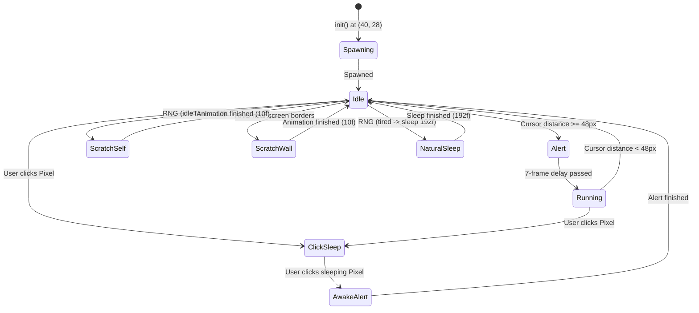

# Complete Cat Character Technical Guide & Interaction System

**Character Name:** Pixel  
**Role:** Interactive Desktop & Mobile Companion  
**Engine Base:** Lightweight modified `oneko.js` animation engine  
**Target Repository:** `primary portfolio website/aniket-portfolio`  
**Last Updated:** November 2026  

---

## 1. Overview of the Cat Character

**Pixel** is a lightweight, responsive pixel-art cat companion that inhabits the portfolio. The character:
- Runs in pure client-side JavaScript without external game libraries or heavyweight canvas dependencies.
- Automatically tracks cursor movements smoothly across 8 directions (North, North-East, East, South-East, South, South-West, West, North-West) at 10 pixels per frame.
- Automatically enters realistic feline idling behaviors (scratching self, scratching walls, taking spontaneous naps) when the cursor stops moving.
- Can be clicked/tapped at any moment to put Pixel to sleep, which displays a dedicated sleeping cat sprite along with a floating, floating-animated `z-z-Z` indicator.
- Automatically pauses execution when the browser tab is hidden or when the user has enabled OS-level reduced motion (`prefers-reduced-motion`).

---

## 2. Complete List of Implemented Actions

| Action Name | Visual State | Trigger Mechanism | Mode | Duration | Subsequent Behavior | Controlling Function / Asset |
| :--- | :--- | :--- | :--- | :--- | :--- | :--- |
| **Spawn / Initialize** | Appears at navbar position `(40px, 28px)` facing forward | Page load (`afterInteractive`) | Automatic | Instant | Evaluates cursor distance in animation loop | `init()` in `oneko.js`; `petConfig.spawn` in `pet.ts` |
| **Alert / Attention** | Ears perk up, eyes wide, body braces | Cursor moves away while cat was idle | Automatic | 7 frames (~700ms) | Transitions to directional running toward cursor | `frame()` lines 395-401; sprite: `alert` (`[-7, -3]`) |
| **Run / Chase Cursor** | 2-frame running walk cycle in direction of target | Cursor distance $\ge$ 48px from cat | User-driven (mouse move) | As long as cursor moves | Transitions to `idle` when within 48px | `frame()` lines 403-420; sprites: `N, NE, E, SE, S, SW, W, NW` |
| **Default Idle** | Sits upright facing viewer quietly | Cursor stays within 48px radius | Automatic | Indefinite until moved or idle action triggers | Cycles into spontaneous idle actions every ~20s | `idle()` line 366; sprite: `idle` (`[-3, -3]`) |
| **Self Scratch** | Sits and rapidly scratches ear with hind leg | Autonomous RNG during idle | Automatic | 10 frames (~1s) | Returns to default idle | `idle()` lines 359-364; sprite: `scratchSelf` (`[-5,0], [-6,0], [-7,0]`) |
| **Scratch Wall West** | Reaches up and scratches the left screen border | Autonomous RNG when `nekoPosX < 32` | Automatic | 10 frames (~1s) | Returns to default idle | `idle()` line 358; sprite: `scratchWallW` (`[-4,0], [-4,-1]`) |
| **Scratch Wall East** | Reaches up and scratches the right screen border | Autonomous RNG when `nekoPosX > window.innerWidth - 32` | Automatic | 10 frames (~1s) | Returns to default idle | `idle()` line 357; sprite: `scratchWallE` (`[-2,-2], [-2,-3]`) |
| **Scratch Wall North** | Reaches up and scratches the top screen border | Autonomous RNG when `nekoPosY < 32` | Automatic | 10 frames (~1s) | Returns to default idle | `idle()` line 355; sprite: `scratchWallN` (`[0,0], [0,-1]`) |
| **Scratch Wall South** | Reaches down and scratches the bottom border | Autonomous RNG when `nekoPosY > window.innerHeight - 32` | Automatic | 10 frames (~1s) | Returns to default idle | `idle()` line 356; sprite: `scratchWallS` (`[-7,-1], [-6,-2]`) |
| **Autonomous Nap (Unclicked)** | Shows tired face, curls into ball with animated 2 `z z` expanding/contracting | Prolonged idle when unclicked (~every 20s at random) | Automatic | 8 frames tired + 192 frames sleeping (~20s) | Automatically wakes up and returns to default idle | `idle()` lines 345-354; `cat.png` frames `[-2,0]` & `[-2,-1]` |
| **Interactive Sleep (Clicked)** | Curls into clean sleeping ball (`pixel-cat-sleep.png`) + 3 separate floating CSS `z z Z` letters appear | Left click (desktop) or tap (mobile) on Pixel | User-driven (click) | Indefinite until clicked or tapped again | Stays asleep until user wakes Pixel | `goToSleep()` lines 278-291; `pixel-cat-sleep.png` + `#pixel-zzz` |
| **Wake Up (Click)** | Jumps up into Alert stance, hides ZZZ and hint | Left click (desktop) or tap (mobile) while asleep | User-driven (click) | Instant | Enters alert mode, then resumes cursor tracking | `wakeUp()` lines 293-309 |
| **Wake Up Tooltip** | Displays floating badge: `"Wake up Pixel"` below cat | Hover cursor over sleeping cat | User-driven (hover) | While hovered | Hides when mouse leaves cat | `mouseenter` / `mouseleave` lines 185-198; `#pixel-wake-hint` |
| **Separate ZZZ Float** | Cascading `z z Z` letters gently floating upwards | Active while `isAsleep === true` | Tied to sleep state | Continuous CSS loop | Instantly hidden on wakeup | `positionZzz()` lines 261-265; `#pixel-zzz` in `globals.css` |

---

## 3. How to Trigger Every Action (Interaction Guide)

| User Action | Interaction Target | Resulting Behavior |
| :--- | :--- | :--- |
| **Click / Tap Cat** | Click body of Pixel | If awake: immediately transitions to sleep mode and shows floating ZZZ.<br>If asleep: instantly wakes up in Alert stance. |
| **Hover Cat (Asleep)** | Move mouse over sleeping Pixel | Displays tooltip badge directly below the cat saying `"Wake up Pixel"`. |
| **Move Mouse** | Anywhere across the page | Pixel turns toward cursor and runs until within 48px proximity. |
| **Stop Moving Mouse** | Leave cursor in place | Pixel arrives near cursor, sits down, and quietly watches. |
| **Wait (Idle)** | Keep page open without moving | After ~20 seconds of inactivity, Pixel randomly grooms itself, scratches a nearby screen border, or curls up for a quick nap. |
| **Switch Tabs / Hide Page** | Switch to another browser tab | Animation loop cleanly pauses via `document.hidden` check to preserve CPU/battery life. |

---

## 4. Animation States & Transitions



---

## 5. Asset & Component Locations

### 5.1 Normal Cat Asset
- **File:** `public/oneko/cat.png`
- **Format:** 256×128 RGBA Transparent PNG (8 columns × 4 rows of 32×32 pixel sprites).
- **Embedded ZZZ:** Retained in both autonomous sleeping frames (`col 2, row 0` and `col 2, row 1`) to provide the authentic 2-frame animated pixel art `z z` whenever the cat naturally falls asleep while active without being clicked (Image 1).

### 5.2 Interactive Sleeping Cat Asset
- **File:** `public/oneko/pixel-cat-sleep.png`
- **Format:** 32×32 RGBA Transparent PNG.
- **Embedded ZZZ:** Cleaned and removed (`y=9..14, x=8..13` and `y=10..14, x=18..21`). Used exclusively when the user clicks the cat, pairing with the 3 floating CSS `z z Z` letters (`#pixel-zzz`) with zero duplicates (Image 3).

### 5.3 Separate ZZZ Animation
- **DOM Element:** `#pixel-zzz` (Created dynamically in `public/oneko/oneko.js` line 171: `document.createElement("div")`).
- **Positioning Function:** `positionZzz()` in `public/oneko/oneko.js` lines 261-265. Anchored at `left = (nekoPosX - 2)px`, `top = (nekoPosY - 26)px`.
- **CSS Styling & Animation:** `src/app/globals.css` lines 285-333:
  - Animation: `@keyframes pixel-zzz-float { 0%, 100% { transform: translateY(0); } 50% { transform: translateY(-2px); } }`
  - Font sizes: 8px (`z`), 9px (`z`), 11px (`Z`).
  - Colors: Subtle high-contrast mono grey `oklch(0.58 0 0)`.

### 5.4 Main Component & Supporting Files
| File Path | Component / Role | Description |
| :--- | :--- | :--- |
| `src/components/cursor-pet.tsx` | `<CursorPet />` | Next.js Client Component mounting `oneko.js` via `next/script` with dataset properties. |
| `src/config/pet.ts` | `petConfig` | Global config object: `enabled`, `name: "Pixel"`, `wakeText: "Wake up Pixel"`, `spawn: { x: 40, y: 28 }`, `persistPosition: false`. |
| `public/oneko/oneko.js` | `oneko()` | Core animation loop, event handling, physics, sprite indexing, and DOM injection. |
| `src/app/globals.css` | `#pixel-zzz`, `#pixel-wake-hint` | Visual styling, typography, z-index (`2147483647`), and floating keyframe animation. |
| `src/app/layout.tsx` | `<RootLayout />` | Renders `<CursorPet />` into the global layout shell. |

---

## 6. Previous Dog-to-Cat Replacement Audit

1. **Original Dog Implementation:**  
   The initial companion was a pixel puppy driven by `public/oneko/puppy.png` and `public/oneko/pixel-sleep.png` / `mowgli-sleep.png`.
2. **Files Changed in Replacement:**  
   - `src/components/cursor-pet.tsx`: updated `data-cat` from `puppy.png` to `cat.png`, and `data-sleep` from `pixel-sleep.png` to `pixel-cat-sleep.png`.
   - `public/oneko/cat.png`: introduced canonical 256×128 pixel cat sprite sheet.
   - `public/oneko/pixel-cat-sleep.png`: introduced 32×32 transparent sleeping cat sprite.
3. **Dog Assets Status:**  
   The original puppy assets (`puppy.png`, `pixel-sleep.png`, `mowgli-sleep.png`) were preserved in `public/oneko/` to ensure non-destructive versioning.
4. **Preserved Animation Logic:**  
   - 100% of movement physics, 8-directional sprite offsets, alert countdowns, wall-scratch logic, and proximity boundaries were kept identical.
   - Pet name was strictly kept as **`Pixel`**.
   - Wake prompt text was strictly kept as **`Wake up Pixel`**.
   - Sleeping ZZZ animation mechanism was strictly preserved.

---

## 7. How to Modify the Cat's Appearance or Add Animations

### 7.1 Editing Existing Sprites
- Open `public/oneko/cat.png` in any pixel-art editor (Aseprite, Photoshop, Pixelorama).
- Keep the grid strictly at 32×32 pixels per frame.
- Keep background transparent (`RGBA: 0, 0, 0, 0`).
- If editing the click-sleep pose, mirror the changes in `public/oneko/pixel-cat-sleep.png`.

### 7.2 Adding a New Animation Safely
1. Place the new frames into available cells in `public/oneko/cat.png`.
2. Open `public/oneko/oneko.js`.
3. Add a new key to `spriteSets`:
   ```javascript
   myNewAnimation: [
     [-colIndex, -rowIndex],
     [-colIndex2, -rowIndex2],
   ]
   ```
4. Trigger the animation either inside `idle()` by appending to `avalibleIdleAnimations`, or by adding a custom event listener in `init()`.
5. Reset animation cleanly when complete using `resetIdleAnimation()`.

---

## 8. Known Limitations & Non-Implemented Features
- **Touch Dragging:** Pixel responds to taps on mobile (triggering sleep/wake), but does not follow continuous touch finger drag gestures.
- **Keyboard Controls:** Pixel does not have WASD or Arrow-key bindings; it is exclusively mouse/tap reactive.
- **Physics Collisions:** Pixel treats screen edges as boundaries, but does not detect or climb internal UI DOM elements (like buttons or cards).

